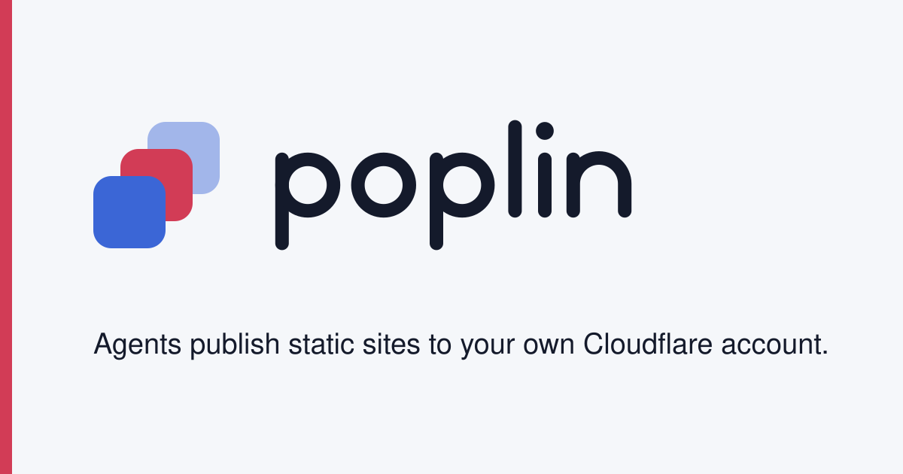
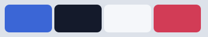
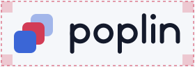

# Brand

## Files

| file | what it is | drawn on | preview |
|---|---|---|---|
| `icon.svg` | the icon, in colour | 64 x 64 |  |
| `icon-mono.svg` | the icon in one colour; takes `currentColor`, ink by default | 64 x 64 |  |
| `favicon.svg` | the icon redrawn for 16 px and 32 px | 16 x 16 |   |
| `lockup.svg` | the icon beside the word; the word takes `currentColor`, ink by default | 248 x 64 |  |
| `social.svg` | the lockup and the one-line description; the description is set in a system font stack | 1200 x 630 |  |
| `palette.svg`, `use.svg`, `clear-space.svg`, `misuse.svg` | the pictures on this page | - | below |

Every file is hand-written SVG. Rasters are produced at build time from these files; none is stored here.

## Palette

| name | hex | role | contrast on paper | contrast on ink |
|---|---|---|---|---|
| shirting blue | `#3B66D6` | main | 4.82:1 | 3.35:1 |
| ink | `#141A2B` | text, dark ground | 16.14:1 | - |
| paper | `#F5F7FA` | light ground | - | 16.14:1 |
| selvedge red | `#D23C56` | accent | 4.33:1 | 3.73:1 |

The back sheet of the icon is shirting blue at 45% opacity. In `icon-mono.svg` the three sheets are 100%, 60%, and 30% of one colour.

## Do

| tile | ground | file |
|---|---|---|
| left | paper | `icon.svg` |
| middle | ink | `icon.svg` |
| right | shirting blue | `icon-mono.svg` with `color` set to paper |

## Clear space

The dashed line is the edge of the clear space. Each corner square is one quarter of the icon height; that much stays empty on every side of the icon or the lockup.

## Minimum sizes

| file | minimum | shown at minimum |
|---|---|---|
| `favicon.svg` | 16 px |  |
| `icon.svg` | 32 px |  |
| `icon-mono.svg` | 32 px |  |
| `lockup.svg` | 24 px high |  |

## Do not

| tile | do not |
|---|---|
| 1 | change the colours |
| 2 | move or reorder the sheets |
| 3 | rotate |
| 4 | stretch |
| 5 | put `icon.svg` on shirting blue |
